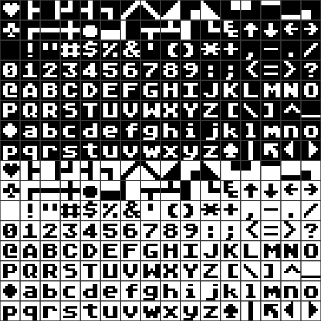

# Edit Atari

A text editor for Atari 8-bit computer files, for Linux, Windows and macOS.
It edits ATASCII text (Atari BASIC `LIST` files, Action!, Assembler Editor and
MAC/65 source saved as text), with `$9B` line endings, and tokenized programs
from nine Atari languages, all in the real Atari character set.

The program is a single file with nothing else to install: the Atari
character set is built in.



## Features

- Shows all 256 ATASCII characters, including graphics and inverse video.
- Atari keyboard behaviour on a PC keyboard:
  - **RIGHT-CTRL** acts as the Atari CONTROL key, so left Ctrl stays free
    for editor commands. Any Ctrl or Alt key can be chosen instead: F7
    switches between left and right, F8 between Ctrl and Alt (or set both
    in Preferences). If the left Ctrl is the CONTROL key, the right one
    does the editor commands. On a Mac, where the commands use ⌘, the left
    **control** key is the Atari CONTROL key by default, and Option can be
    chosen instead.
  - **Esc** before a key inserts that key's character instead of performing
    its action, as on the Atari: Esc then cursor-up inserts the up-arrow
    character.
  - The **`** key (left of 1) is the Atari inverse key: it turns inverse
    video on or off for typed characters.
  - **Caps Lock** clicks like the Atari's CAPS key.
- **F6** switches between the standard and the XL/XE international
  character set (accented letters in place of the graphics at $00-$1A, $60
  and $7B). With it on, accented letters typed on the PC keyboard are
  inserted as their Atari codes, and copy/paste uses real accented letters.
  - **Tab** follows the Atari's tab stops (power-up stops at screen columns
    7, 15, 23, 31 and 39 of each row). Shift+Tab sets a stop at the cursor
    and CONTROL+Tab clears one; with no stops left in the logical line, Tab
    moves to the start of the next line.
- Line length warning: characters past column 114 (the Atari screen
  editor's 3 x 38 logical line) are shown in orange, and the status bar
  shows the line's length. Change the limit or turn it off in Preferences.
- 40-column Atari layout with the 2-column margin, or wrapping at the window
  width (F4).
- Line numbers (Options > Line Numbers): each line's number in the editor,
  in a column left of the text that doesn't take any of the Atari's 40
  columns. The cursor's line is highlighted. They can be printed too.
- The XL/XE key click, reproduced from the Atari OS click routine (F5 turns it
  off).
- A steady cursor, as on the Atari, or a flashing one (Options > Flashing
  Cursor).
- Atari font files (`.FNT`, 1024 bytes, as Atari font editors save them;
  also as DOS binary-load files) can replace the standard and
  international character sets: Options > Fonts shows each set's
  characters, with a Browse button and a Built-in check box: ticking it
  goes back to the built-in set, unticking it brings back the last font
  loaded. The chosen fonts are used
  on screen, in the Find boxes and when printing. Two fonts come with it
  (`BIG.FNT` and `BIGINTL.FNT`, in the download's `fonts/FNT` folder, and
  in the source's `assets/fonts/FNT`); Browse starts there.
- Imports and exports PC text: UTF-8 for the Atari font, standard Unicode,
  or plain ASCII with `{tags}` (see [File types](#file-types)).
- Prints with the Atari characters, by way of a PDF (File > Print to PDF).
- Find and Replace, typed in Atari text with the editor's own keys, and
  Go to Line by BASIC or MAC/65 line number or by editor line.
- Opens and saves tokenized programs from nine Atari languages (seven
  BASICs, Microsoft BASIC II and MAC/65), exactly as each language saves
  them (see [File types](#file-types)).
- Opens and saves files inside Atari disk images (`.ATR` and `.XFD`) on
  Atari DOS 2, MyDOS and SpartaDOS disks, directories included, and makes
  new blank images (see [Disk images](#disk-images)).

- File, Edit, Options and Help menus, with the usual shortcuts (Ctrl+N, O,
  S, P, Z, Y, X, C, V, A; on a Mac ⌘N, ⌘O, ⌘S and so on, with ⇧⌘Z for
  Redo and ⌘-arrows for the start and end of a line or the file),
  Ctrl+Left/Right (⌥ on a Mac) to move by words, with Shift to select,
  underlined hot keys (Alt+F then Q quits), a right-click menu
  (Control-click on a Mac), and the system's own Open and Save dialogs.
- Drop a file on the window to open it. Drop several and the first opens
  in that window, each of the others in a new window of its own. On a Mac,
  Finder's *Open With* offers Edit Atari for any file.
- File > Recent Files lists the last six files opened or saved, files in
  disk images included (`MYDISK.ATR > SAMPLE.LST`).
- If another program (an emulator saving through its H: device, say)
  changes the open file, the editor notices when you come back to it: it
  reloads the file, or asks first if you have unsaved changes, and asks
  before a Save would replace the other program's version.
- Several windows can be open at once; each saves only the preferences
  changed in it.
- The window opens at the size it had when last closed, maximized if it
  was (the window closed last decides).
- A Preferences page (Options > Preferences, Ctrl+, or F9): display width,
  line numbers, zoom, text and background colours, character set, key click, flashing
  cursor, CONTROL key, line length warning, attract mode, default folder (last used or a
  fixed one), and whether to save preferences on exit. Changes apply at
  once; "Save Preferences" writes them immediately.
- Colours are chosen the Atari way, by hue (0-15) and luminance (0-14), from
  an approximation of the NTSC palette; the default is the text screen's
  $94 background with $9A text.
- Attract mode: after a few minutes without input (5 by default), the
  screen colours change every 4.3 seconds exactly as the Atari OS does it
  (XOR with a changing value, then dimmed with DRKMSK = $F6). Any key press
  or mouse use restores them.
- Select text with Shift+arrows or the mouse; selected text is shown in its
  own colour so it isn't confused with inverse characters. Copy and paste work with
  other programs: ordinary characters paste as plain text, and Atari
  graphics characters use the same private Unicode characters as the
  EightBit Atari font, so they paste back exactly.
- Undo and redo.

Press **F1** (or Help > Keyboard Help) for the full list of keys.

## File types

The editor reads programs as each language saves them, shown as the
language's own LIST would show them, and plain ATASCII text. Help > File
Types lists these in the program too.

| Extension | Contents                                                  |
|-----------|-----------------------------------------------------------|
| `.BAS`    | Atari BASIC, tokenized (see below)                        |
| `.TUR`    | Turbo-BASIC XL, tokenized                                 |
| `.ATB`    | Altirra BASIC, tokenized                                  |
| `.AXB`    | Altirra Extended BASIC, tokenized                         |
| `.BXL`    | OSS BASIC XL, tokenized                                   |
| `.BXE`    | OSS BASIC XE, tokenized                                   |
| `.BAP`    | OSS BASIC A+, tokenized                                   |
| `.AMB`    | Microsoft BASIC II, tokenized (including LOCKed programs) |
| `.M65`    | MAC/65 source, tokenized                                  |
| `.LST`    | Program listings (`LIST "D:FILE"`), ATASCII text          |
| `.ASM`    | Assembler source (MAC/65, Assembler Editor), ATASCII text |
| `.LGO`    | Atari Logo (Logo's SAVE writes text)                      |
| `.PIL`    | Atari PILOT (PILOT's SAVE writes text)                    |
| `.FB`     | FastBASIC source, ATASCII text                            |
| `.ACT`    | Action! source, ATASCII text                              |
| `.TXT`    | Other ATASCII text                                        |

Any BASIC may also be saved as `.BAS`, as was usual at the time: the
dialect is recognized from the file itself.

- **Opening** reads any of these whatever the file is called. The Open
  and Save dialogs list each language as its own file type. The
  extensions in the table help tell apart dialects that share token numbers
  (Turbo-BASIC XL and BASIC XL, say); File > Reopen As reads a file as
  another format.
- **Saving**: every format can be saved, tokenized exactly as its language
  saves it.
  Save As picks the format from the extension you give, asking which BASIC
  for `.BAS`. File > Save Listing As always saves ATASCII text (a `.LST`
  listing), whatever the name. Lines with syntax errors are saved, if you
  agree, as `ERROR-` lines, as Atari BASIC itself stores them. A line
  that would be over 255 bytes tokenized (the most a BASIC or MAC/65 line
  can hold) stops the save, with a message listing the lines to shorten.
- **Exporting**: File > Export writes the document as PC text, with the
  PC's line endings, in one of three forms:
  - *Atari Font*: UTF-8, with printable ASCII as itself and every other Atari
    character in the Unicode Private Use Area (U+E000 + its code), where
    the EightBit Atari font has the Atari characters. Install
    [`assets/fonts/atari/EightBit Atari-Regular.ttf`](assets/fonts/atari/)
    to see them in other programs. The copy and paste uses the same
    characters.
  - *Standard*: UTF-8 with ordinary Unicode symbols, readable in any font:
    the symbols the EightBit Atari font itself gives the graphics (heavy
    box drawing ┣ ━ ┛, blocks ▄ ▌ ▖, ♥ ♣ ♦ ♠, arrows, ◀ ▶, ⤣ for CLEAR).
    Inverse video has no Unicode equivalent except a few block shapes
    (inverse space is █); other inverse characters export as normal ones,
    and Export warns first, saying how many.
  - *ASCII*: plain ASCII, with other characters as tags: `{CTRL-A}` to
    `{CTRL-Z}`, `{CTRL-,}` `{CTRL-.}` `{CTRL-;}`, `{ESC}`, `{UP}` `{DOWN}`
    `{LEFT}` `{RIGHT}`, `{CLEAR}`, `{BACK}`, `{TAB}`, `{DEL LINE}`
    `{INS LINE}` `{CLR TAB}` `{SET TAB}` `{BELL}` `{DEL CHAR}` `{INS CHAR}`,
    and `{INV}`...`{/INV}` around inverse characters.

  The document keeps its own file and format.
- **Printing**: File > Print to PDF (Ctrl+P) lays the document out on
  Letter or A4 pages, 40 characters a line or as wide as the page, at the
  character size you choose (5 to 24 points), with an optional header of
  the file name and page numbers, and saves it as a PDF where you choose.
  The characters are drawn from the editor's own Atari character set, so
  graphics and inverse video print exactly as on screen and no font needs
  installing. With *Open the PDF to print it* ticked, the PDF then opens in
  your PDF viewer, whose Print command chooses the printer and pages. The
  settings are remembered.
- **Finding**: Edit > Find (Ctrl+F) opens a panel at the top right. Its
  Find and Replace boxes are Atari text, typed with the same keys as the
  document: the inverse key, CONTROL+letter graphics, Esc for cursor and
  other control characters, the arrow keys, Insert and Delete. Text
  selected on one line when Find opens is filled in. Without *Match case*,
  letters match in either case; without *Match inverse*, characters match
  in normal or inverse video. Enter or Find Next (F3) finds the next
  match, Shift+Enter or Shift+F3 the previous, wrapping round the file;
  Replace replaces the found text and finds the next; Replace All is one
  Undo step. Clicking in the text gives the keys back to the document,
  leaving the panel open; Close (or Esc on its buttons) closes it.
  Edit > Go to Line (Ctrl+G) jumps to the nth line in the editor, as
  counted by "Ln" in the status bar (the last line if there are fewer).
  With *Editor line* unticked it goes by BASIC or MAC/65 line number
  instead: a line number that isn't there goes to the next one up, and
  one above the highest goes just past that line (the start of the next
  line, or the end of that one). On a Mac: ⌘F, ⌘G, ⇧⌘G, ⌥⌘F and ⌘L.
- **Importing**: File > Import reads a PC text file (any line endings,
  UTF-8 or not) as ATASCII: tags and Private Use characters become their
  Atari codes, a tab becomes the Atari TAB, and accented letters the
  international character set's codes. Characters with no Atari equivalent
  become `?`, and the status bar says how many. Exported files read back
  exactly. The result is a new document: Save asks for a name (suggesting
  `.LST`), so the PC file isn't overwritten.

  If the file is a numbered BASIC or assembler listing with lower case,
  Import offers to convert it to capitals, which Atari BASIC and the
  assemblers need. Strings are left as they are, and so are REM and DATA
  (and the `.` `!` `'` `--` remarks) in BASIC and `;` comments and `'c`
  constants in assembler.

  Open never converts: every byte is read as the Atari's, so a `$9B` is
  always a line end and a PC line feed is a CTRL-J character. If a file
  looks like PC text, the status bar suggests File > Import.

## Disk images

The editor reads and writes the files inside Atari disk images, so a
program can go straight from the editor to an emulator or a real Atari
(through an SIO2PC or SD card device) and back. It reads `.ATR` images
(128, 256 and 512-byte sectors) and `.XFD` images (128-byte sectors),
with these file systems:

- Atari DOS 2: 2.0S, 2.0D, and DOS 2.5 enhanced density
- MyDOS 4.x, with subdirectories
- SpartaDOS 2.x and 3.x, and SpartaDOS X, with subdirectories, dates and
  volume names

A disk with any other DOS (or none, like most game disks) can't be opened.

- **Opening**: File > Open from Image opens the image last used (or asks
  for one) and shows its directories on the left, starting with `>` for
  the top directory as SpartaDOS writes it, and the chosen directory's
  files on the right, listed as DIR lists them: name and extension, size,
  the date on SpartaDOS, and `*` for a locked file. Names are shown in the
  Atari character set, so even an odd name written by another program shows
  exactly. Choose Image... picks another image. Double-click a file, or
  select it and press Enter or Open; Enter or a double-click on a directory
  goes into it, and Backspace goes back up. The arrows at the side of each
  list show that it runs on above or below, and scroll it.
- **The image stays the document's home**: the title bar and status bar
  show where it came from (`MYDISK.ATR > SAMPLE.LST`), Save (Ctrl+S)
  writes it back into the image, and Recent Files lists it the same way.
- **Saving**: File > Save to Image shows the same page with a File name
  box, which starts with the document's name. Names are typed to suit the
  disk's DOS: lower case becomes capitals, characters the DOS can't use
  (`_` on DOS 2, say) are left out, and if the name still breaks a rule
  (up to 8 characters, a dot and up to 3 more; DOS 2 names start with a
  letter) the reason is shown and Save waits. Clicking a file in the list
  takes its name. The format comes from the extension, as with Save As.
  Saving over a file that's there asks first; a locked file is refused.
  On SpartaDOS, files are dated with the computer's clock.
- **Create Directory** (on the Save to Image page, for MyDOS and SpartaDOS
  disks) makes a directory inside the one shown, and goes into it.
- **New Image** (on the Save to Image page) makes a blank, formatted data
  disk and asks where to save it:
  - Atari DOS 2: 2.0S single density (90K), 2.5 enhanced density (130K)
    or 2.0D double density (180K)
  - MyDOS or SpartaDOS: single (90K), enhanced (130K) or double density
    (180K), double-sided (360K or 720K), or a custom size (up to 65535
    sectors of 128 or 256 bytes, or 512 bytes for SpartaDOS X), for hard
    disk partitions
  - `.ATR`, or `.XFD` for disks with 128-byte sectors
  - a volume name on SpartaDOS

  The new disks have no DOS on them, so they can't be booted: use them
  as data disks, or write DOS to them with the DOS's own menu in an
  emulator.
- **Safety**: every change reads the image file again, makes the change,
  and writes the whole image back (to a temporary file that then replaces
  it), so a failed save leaves the image as it was. Images marked
  write-protected (the ATR flag) are never changed. The editor doesn't
  delete, rename, copy or lock files on a disk; use the DOS for that.

**Don't change an image that's open in another program.** An emulator
with the image mounted (in Altirra, say) keeps its own copy of the disk
and can write it back over the editor's changes, or the editor over the
emulator's. Unmount the image, or mount it read-only, while saving to it
from the editor. If another program changes the file you're editing in an
image, the editor notices, as it does for ordinary files, and asks before
a save would replace that program's version.

The disk images are read and written by
[atari-disk](https://github.com/Calab/atari-disk), a library of its own
that other programs can use too.

## Installing

Download the package for your computer from the
[Releases](https://github.com/Calab/edit_atari/releases) page:

| Package                                      | For                                                    |
|----------------------------------------------|--------------------------------------------------------|
| `atari_editor-1.4.0-windows-x86_64.zip`      | Windows 10 and 11                                      |
| `atari_editor-1.4.0-macos-apple-silicon.zip` | Macs with M1 or later chips, macOS 11 or later         |
| `atari_editor-1.4.0-macos-intel.zip`         | Older Macs with Intel processors, macOS 10.13 or later |
| `atari_editor-1.4.0-linux-x86_64.tar.gz`     | 64-bit Linux                                           |

- **Windows**: unzip it anywhere and run `atari_editor.exe`. To make a
  shortcut, right-click it and choose *Create shortcut* (or *Pin to Start*).
  The program isn't signed, so the first time Windows SmartScreen may say
  it "protected your PC": choose *More info*, then *Run anyway*.
- **macOS**: unzip it and drag *Edit Atari* to Applications. The app
  isn't notarized by Apple, so the first time macOS refuses to open it:
  open *System Settings > Privacy & Security*, scroll down and click
  *Open Anyway* (on older macOS, right-click the app and choose *Open*).
- **Linux**: unpack it and run `./install.sh` in its folder. That puts the
  program in `~/.local/bin` and adds *Edit Atari* to your applications
  menu with its icon. Or just run `./atari_editor` from the folder.

Each package also has the `fonts` folder with the EightBit Atari font.
Install it (double-click it on Windows or macOS; copy it to
`~/.local/share/fonts` on Linux) to see Atari characters in other programs,
in files saved with File > Export as *Atari Font*.

## Usage

```
atari_editor FILE.LST
```

If the file doesn't exist it is created when you save (Ctrl+S). You can also
start the editor without a file and use File > Open.

## Building

Install Rust from <https://rustup.rs> and CMake, then:

```
cargo build --release -p atari_editor
```

The program is written to `target/release/atari_editor`. SDL2 is compiled
from source and linked in, so the result doesn't need SDL installed.

On Linux, building SDL needs the X11/Wayland/audio development packages; see
`.github/workflows/build.yml` for the list. GitHub Actions builds Linux,
Windows and macOS (Apple Silicon and Intel) packages on every push; pushing
a version tag such as `v1.0.0` also publishes them as a GitHub Release.

The icons in `assets/icons` (PNG sizes, `.ico` for Windows, `.icns` for
macOS) are the Atari font's `A` in the default colours, made with:

```
cargo run -p fontgen -- icon crates/atari/src/font_atascii.bin 41 1A55A8 8CC4FF \
    assets/icons/atari_editor
```

### Developing in VS Code

Open the folder in VS Code and install the recommended extensions when
prompted (rust-analyzer, CodeLLDB, Even Better TOML). Then press **F5** to
build and run the editor on `samples/SAMPLE.LST`, or pick "Edit Atari:
choose a file" in the Run and Debug view.

## Project layout

| Path                | Contents                                                                                  |
|---------------------|-------------------------------------------------------------------------------------------|
| `crates/retro_core` | Machine-independent editor: document, layout, keyboard and disk image interfaces          |
| `crates/retro_sdl`  | SDL2 window, drawing, sound and settings, shared by all machines                          |
| `crates/atari`      | Atari specifics: ATASCII, character set, keyboard rules, key click                        |
| `apps/atari_editor` | The Atari editor program, and its disk images (through the atari-disk library)            |
| `tools/fontgen`     | Converts the pixel TrueType font into the built-in 8x8 character set, and makes the icons |
| `assets/`           | Fonts and program icons                                                                   |
| `packaging/`        | Release extras: Linux menu entry and installer, macOS app details                         |
| `docs/`             | Design notes and tokenized-language references                                            |

The machine-specific parts sit behind the `Machine`, `KeyboardRules` and
`DiskImages` traits, so an editor for another 8-bit computer (e.g. a Commodore 64 PETSCII
editor) can reuse `retro_core` and `retro_sdl`.

### Regenerating the character set

```
cargo run -p fontgen -- build "assets/fonts/atari/EightBit Atari-Regular.ttf" \
    E000 256 crates/atari/src/font_atascii.bin docs/images/font_atascii_sheet.png
```

The tool refuses to write output if any glyph outline is off the 8x8 pixel
grid. The international set (`E100 256 crates/atari/src/font_international.bin
docs/images/font_international_sheet.png --lenient`) needs `--lenient`: 16
accented letters have outline points between pixel centres that don't change
any pixels, and were checked by eye.

## Licences

- The editor's source code is licensed under the GNU General Public License,
  version 3 or later (see `LICENSE`).
- The character set is derived from the font "EightBit Atari", © 2018 Steve
  Boswell, used under the SIL Open Font License 1.1 (see
  `assets/fonts/atari/OFL.txt`).
- The menus and status bar use the system's interface font. When it can't
  be found, the built-in Noto Sans (© Google, SIL Open Font License 1.1, see
  `assets/fonts/ui/OFL.txt`) is used instead.
- The libraries built into the program (SDL2 and Rust crates) are under
  permissive licences (Zlib, MIT, Apache-2.0); they're listed in
  `apps/atari_editor/THIRD_PARTY.txt`. Regenerate it with
  `tools/third_party.sh` after changing dependencies.
- All of these are shown in the editor under Help > Licensing.
